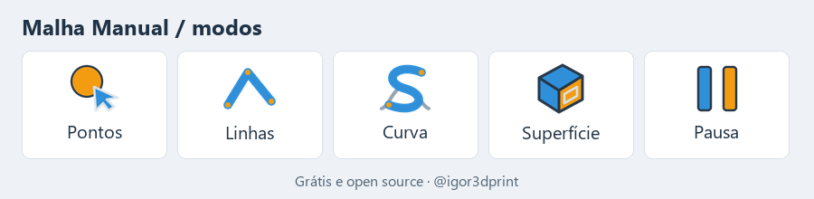

# IgorSurface

Plugin gratuito e open source para **Autodesk Fusion** que transforma scans 3D e malhas STL em geometria CAD editável (esboços, transições e superfícies).

Feito por [@igor3dprint](https://www.instagram.com/igor3dprint/) · [Curso de modelagem e impressão 3D](https://hotmart.com/pt-br/club/igor3dprint)

## Instalar (Windows, o jeito fácil)

1. Baixe o **[IgorSurface-Setup.exe](../../releases/latest)** na última versão.
2. Abra e clique em **Instalar no Fusion**. Se o Windows avisar, use *Mais informações > Executar assim mesmo* (o exe não é assinado; o código está todo aqui).
3. No Fusion: **Utilities > Add-Ins** (Shift+S) > aba **Add-Ins** > **IgorSurface** > **Run** (marque *Run on Startup*).
4. O painel **IGOR SURFACE** aparece nas abas Solid, Surface e Mesh.

Para atualizar, rode o Setup novo com o Fusion fechado.

Instalação manual (Mac ou sem o .exe)

Baixe o ZIP da última versão e copie a pasta `IgorSurface` para:
- Windows: `%APPDATA%\Autodesk\Autodesk Fusion 360\API\AddIns\` (ou rode `install.bat`)
- Mac: `~/Library/Application Support/Autodesk/Autodesk Fusion 360/API/AddIns/`

## Ferramentas

| Ferramenta | Para quê |
|---|---|
| **Scan** (menu) | Importar scan (STL/OBJ/PLY), preparar (reduzir), alinhar, achar o plano de simetria |
| **Malha Manual** | Desenhe sobre a peça: pontos, linhas retas, curvas que andam lisas por cima da malha, e faces automáticas. Vira esboço |
| **CriarAuto** | Clique numa face: ela é reconhecida (plano, cilindro, esfera, cone) e vira esboço, com furos. Diz "não reconheci" em vez de chutar |
| **Ajustar Superfície** | Ajusta plano/cilindro/esfera/cone à região clicada e cria a superfície |
| **Plano de Corte** | Escolha um plano, arraste a seta e gire: o corte da malha inteira aparece ao vivo. OK cria os esboços em *Plano de corte > Corte manual N* |
| **Auto Transição** | Clique num grupo de cortes: faz o loft pelos esboços na ordem 1, 2, 3... |
| **Mapa de Desvio** | Pinta a malha pela distância até o CAD (só enquanto a janela está aberta) |
| **IgorOrganizer** | Um clique: cada corpo vira componente com o próprio nome |
| **IgorSave** | Salva .3mf + .f3d juntos |

### Modos da Malha Manual

- **Pontos**: clique cria, clique no ponto apaga, arraste move.
- **Linhas**: clique ponto após ponto; o mesmo ponto 2x encerra.
- **Curva**: como Linhas, mas a linha anda lisa por cima da peça; cada sequência vira uma spline só.
- **Superfície**: clique numa face (plano, chanfro, dentro/fora de cilindro) e ela vira esboço.
- **Pausa**: cliques não fazem nada. **Tab** troca de modo.

Tudo que o plugin cria vai em componentes próprios; ele nunca altera seus corpos.

## Regras de uso

- Grátis, inclusive para uso comercial.
- **Usou em vídeo, live, curso ou post? Cite [@igor3dprint](https://www.instagram.com/igor3dprint/) na descrição.** É a única condição.

## Desenvolvimento

- Python puro (sem numpy), roda dentro do Fusion. Unidades internas em cm.
- `IgorSurface/lib/` = matemática testável sem Fusion. `IgorSurface/commands/<ferramenta>/entry.py` = um comando cada.
- Testes: `for t in tests/test_*.py; do python $t; done` (rodam no CI a cada push).
- Instalador: `installer\build.bat` gera `dist\IgorSurface-Setup.exe` (Python + PyInstaller).
- Pull requests e issues são bem-vindos.

## Licença

[MIT com atribuição em vídeos](LICENSE): use, modifique e distribua à vontade, citando @igor3dprint quando aparecer em conteúdo publicado.
