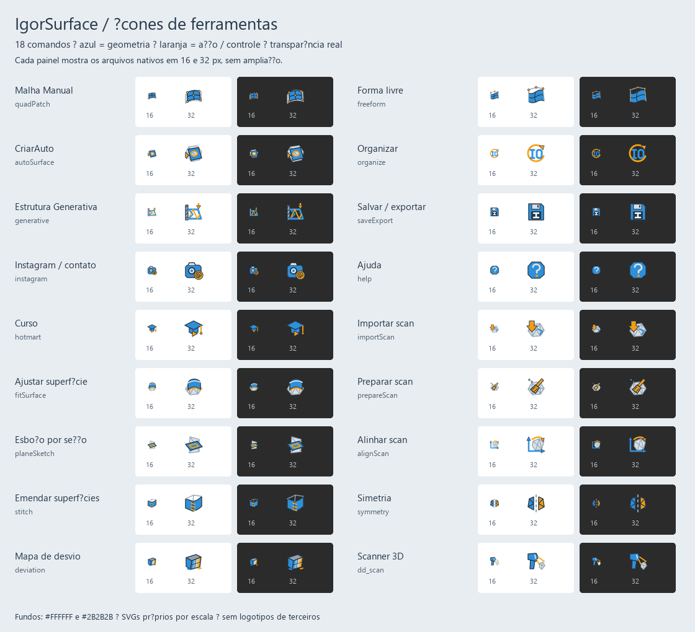

# IgorSurface

Plugin gratuito e open source para **Autodesk Fusion** que transforma scans 3D e malhas STL em geometria CAD editável: esboços e superfícies.

Feito por [@igor3dprint](https://www.instagram.com/igor3dprint/) · [Curso de modelagem e impressão 3D](https://hotmart.com/pt-br/club/igor3dprint)

## O que ele faz

| Ferramenta | Para quê |
|---|---|
| **Scan** (menu) | Importar scan (STL/OBJ/PLY), preparar (reduzir), alinhar, achar o plano de simetria |
| **Malha Manual** | Você clica pontos sobre a peça e liga em linhas; vira esboço. Ideal para scan ruim |
| **CriarAuto** | Clica numa face da malha: ela é reconhecida (plano, cilindro, esfera, cone) e vira esboço, com furos |
| **Ajustar Superfície** | Ajusta plano/cilindro/esfera/cone à região clicada e cria a superfície |
| **Esboço por Seção** | Corta a malha e gera o perfil em linhas e arcos limpos |
| **Mapa de Desvio** | Pinta a malha pela distância até o CAD (só enquanto a janela está aberta) |
| **IgorOrganizer** | Um clique: cada corpo vira componente com o próprio nome |
| **IgorSave** | Salva .3mf + .f3d juntos (opção de salvar ao fechar) |

Tudo que o plugin cria vai num componente **IgorSurface**; ele nunca altera seus corpos.

## Instalar

1. Baixe o ZIP da [última versão](../../releases/latest) (ou *Code > Download ZIP*) e extraia.
2. **Windows:** dê dois cliques em `install.bat`.
   **Mac (ou manual):** copie a pasta `IgorSurface` para
   - Windows: `%APPDATA%\Autodesk\Autodesk Fusion 360\API\AddIns\`
   - Mac: `~/Library/Application Support/Autodesk/Autodesk Fusion 360/API/AddIns/`
3. No Fusion: **Utilities > Add-Ins** (Shift+S) > aba **Add-Ins** > **IgorSurface** > **Run** (marque *Run on Startup*).
4. O painel **IGOR SURFACE** aparece nas abas Solid, Surface e Mesh. O botão **Ajuda** abre esta página.

## Desenvolvimento

- Python puro (sem numpy), roda dentro do Fusion. Unidades internas em cm.
- `IgorSurface/lib/` = matemática testável sem Fusion (ajuste, regiões, curvas). `IgorSurface/commands/<ferramenta>/entry.py` = um comando cada.
- Testes: `for t in tests/test_*.py; do python $t; done` (rodam no CI a cada push).
- Pull requests e issues são bem-vindos.

## Licença

[MIT](LICENSE): use, modifique e distribua à vontade, inclusive comercialmente.
